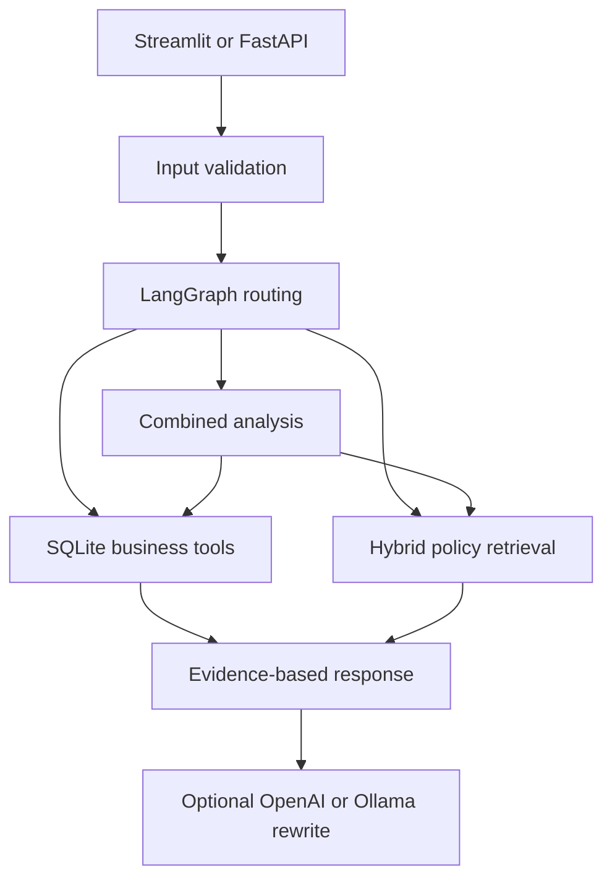

<div align="center">

# Insurance Claims & Policy Intelligence

**Structured facts meet policy evidence.**

`Python` · `LangGraph` · `Hybrid RAG` · `SQLite` · `FastAPI` · `Streamlit`

[Portfolio](https://vekeshportfolio.lovable.app/) · [Developer profile](https://github.com/Vekesh04)

</div>

## Overview

An insurance operations assistant that combines structured database lookups with retrieval over policy documents. The workflow selects a SQL, RAG, or combined route according to the question, then returns an evidence-based summary. It supports an offline demonstration without an API key, with optional OpenAI or Ollama generation.

## What it does

- Looks up claims, policies, customers, hospitals, document status, and interactions through Python tools and SQLite.
- Splits policy documents into chunks and builds a persistent retrieval index.
- Combines vector similarity with BM25 keyword retrieval, product filters, and relevance reranking.
- Uses LangGraph to coordinate safety checks and SQL/RAG/combined workflows.
- Presents answers and retrieved evidence through a Streamlit chat interface and FastAPI backend.
- Includes input checks, unsupported-answer handling, routing tests, retrieval tests, and an evaluation script.

## Architecture



## Dataset

The included dataset is labeled **synthetic** and is intended for a capstone/demo, not live insurance operations.

| Data | Records |
| --- | ---: |
| Customers | 50,000 |
| Policies | 75,000 |
| Claims | 120,000 |
| Claim documents | 600,010 |
| Hospitals | 1,200 |
| Customer interactions | 180,000 |
| Policy documents | 10 |
| Seed evaluation questions | 5 |

Local setup produced **150 policy chunks** using the TF-IDF fallback. SentenceTransformers embeddings are optional; TF-IDF is a lexical vector representation, not a trained semantic embedding model. The five-question evaluation set is a small starting point, not proof of production quality.

Large CSV tables are stored losslessly as `.csv.gz`. The database loader reads them directly through pandas; no manual extraction is required. Row counts and table names are unchanged.

Large CSV tables are stored losslessly as `.csv.gz`. The database loader reads them directly through pandas; no manual extraction is required. Row counts and table names are unchanged.

## Quick start

Use Python 3.10+ and activate a virtual environment.

```bash
python -m venv .venv
# macOS/Linux: source .venv/bin/activate
# Windows: .venv\Scripts\activate
python -m pip install -r requirements.txt
```

Copy `.env.example` to `.env`. For an offline demo, set `LLM_PROVIDER=none`.

```bash
python setup_project.py
python run_demo.py
python -m pytest -q
streamlit run app.py
```

To run the API separately:

```bash
uvicorn api.main:app --reload
```

API documentation is available at `http://127.0.0.1:8000/docs`. The Streamlit UI calls the Python workflow directly; starting FastAPI is optional for that UI.

## Example questions

| Question | Expected route |
| --- | --- |
| What is the status of claim CLM300001? | SQL |
| What is the maternity waiting period under Health Secure Plus? | RAG |
| Analyze claim CLM300001 and tell me if documents are missing. | Combined |

## Source guide

| Path | Role |
| --- | --- |
| `graph/` | Routing and LangGraph state workflow |
| `tools/` | Structured insurance lookups |
| `rag/` | Chunking, embeddings, BM25, retrieval, and indexing |
| `guardrails/` | Input validation and answer checks |
| `services/` | Optional LLM generation |
| `api/`, `app.py` | FastAPI and Streamlit entry points |
| `data/` | Synthetic tabular data and policy documents |
| `tests/`, `evaluation/` | Automated checks and seed evaluation |
| `optional_mcp/` | Separate optional MCP demonstration |

See [the detailed setup and explanation guide](docs/SETUP_AND_VIVA.md) for platform-specific instructions.

## Scope and limitations

This is an educational prototype. It summarizes retrieved evidence; it does not approve claims or determine insurance eligibility. Pattern-based input checks and grounded prompts reduce some failure modes but do not guarantee safety or correctness. No real customer data or API keys should be committed. Generated databases, embedding caches, and virtual environments are excluded from source.

## Author

**Vekesh Makani** · AI Engineer & Python Developer

[Portfolio](https://vekeshportfolio.lovable.app/) · [LinkedIn](https://linkedin.com/in/vekesh-m)
